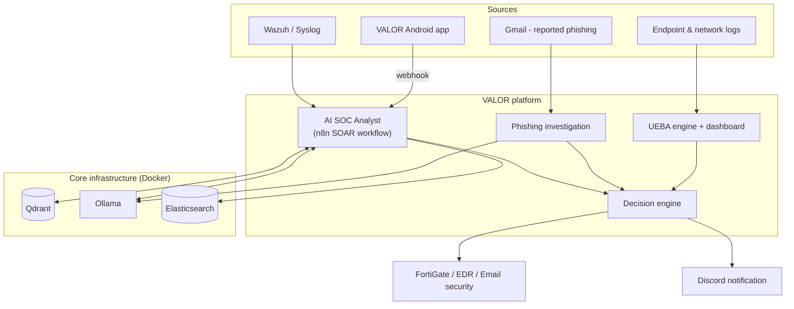

# VALOR — AI-Powered Security Operations Platform

> **VALOR does not react to threats. It prevents them.**

VALOR is a unified security-automation platform that cuts SOC alert fatigue and shortens response time. It combines an **AI SOC analyst** (SOAR workflows on n8n), a **UEBA engine** for insider-threat detection, an **automated phishing-email investigation** flow, a **deterministic decision engine**, and an **Android app** that intercepts malicious links and files before the user opens them. LLM reasoning runs **on-premises** (Ollama), so sensitive telemetry never leaves your environment.

*Graduation project — Cybersecurity, Group 2.*

---

## Table of contents

- [Architecture](#architecture)
- [Components](#components)
- [Tech stack](#tech-stack)
- [Getting started](#getting-started)
- [Repository structure](#repository-structure)
- [Screenshots](#screenshots)
- [Roadmap](#roadmap)
- [Team](#team)
- [License](#license)

---

## Architecture



---

## Components

### 1. AI SOC Analyst — SOAR workflow (n8n)
An autonomous tier-1/tier-2 triage analyst.

- **Ingestion** — SIEM (Wazuh) or syslog alerts arrive via webhook, pass a config loader, then a fast triage gate.
- **Triage gate** — deterministic rule: `(rule level ≥ threshold) OR (ML score ≥ threshold)`. Low-priority alerts are suppressed and indexed to Elasticsearch for audit, saving LLM compute.
- **Deep investigation** — dual-RAG context enrichment on Qdrant, then LLM reasoning (Ollama) and a hybrid scoring engine.
- **Analyst feedback loop** — analyst verdicts (true/false positive) are upserted back into Qdrant so the system keeps learning.
- **Discord chatbot** — natural-language queries grounded in live alert data.

### 2. UEBA engine & dashboard
Hybrid behavioral analytics for insider-threat detection.

- Per-user and per-group behavioral baselines, 28-dimension feature extraction.
- **Hybrid scoring**: Isolation Forest + Autoencoder (weighted 40/60 when both agree) to reduce false positives.
- Incidents are explainable and mapped to **MITRE ATT&CK** (official STIX dataset) with kill-chain stage.
- **Backend**: FastAPI, auto re-detection every 5 minutes · **Storage**: OpenSearch · **Frontend**: React SOC dashboard with role-based views (Administrator, Senior Analyst, Analyst, HR).

### 3. Phishing email investigation
Triggered when a user reports an email.

1. Intake and normalization (headers, body, links, attachments).
2. Seven parallel checks — SPF/DKIM/DMARC (MXToolbox), IP (AbuseIPDB, IPinfo), domain / links / attachments (VirusTotal), subject and body analysis (local Llama 3).
3. Aggregation into one JSON schema.
4. Final LLM agent verdict: **Phishing / Suspicious / Safe**, with summary and remediation advice.
5. Result sent to the SOC Discord channel.

### 4. Decision engine
Turns enrichment into action.

| Threat score | Level | Action |
|---|---|---|
| 0–50 | Low | Log and close |
| 51–70 | Medium | Log, act, notify analyst |
| 71–90 | High | Log and act |
| 91–100+ | Critical | Act, contain, notify analyst |

Response by attack type: **malicious IP** → block via FortiGate API · **compromised endpoint** → isolate via EDR · **malicious email** → quarantine via email-security API. Every alert is appended to a CSV audit log.

### 5. VALOR mobile app (Android)
Real-time protection against malicious links and files in messaging apps (WhatsApp, Telegram, Discord, Gmail…).

- Accessibility Service + file observer (SAF / MediaStore) detect links and files.
- Analysis through an n8n webhook with VirusTotal hash/URL lookups and AI content analysis.
- **Zero Data Retention** — no personal data is stored, logged, or transmitted.
- Built with Kotlin, Jetpack Compose (Material 3), Coroutines + Flow, DataStore.

---

## Tech stack

| Layer | Technology |
|---|---|
| Orchestration / SOAR | n8n |
| SIEM | Wazuh |
| Local LLM | Ollama (`llama3.1:8b`, `nomic-embed-text`) |
| Vector DB (RAG) | Qdrant |
| Search / storage | Elasticsearch, OpenSearch |
| UEBA backend | Python, FastAPI, scikit-learn (Isolation Forest), Autoencoder |
| Dashboard | React |
| Threat intel | VirusTotal, AbuseIPDB, IPinfo, MXToolbox |
| Notifications | Discord bot |
| Response integrations | FortiGate API, EDR, email-security API |
| Mobile | Kotlin, Jetpack Compose |
| Deployment | Docker / Docker Compose on Ubuntu |

---

## Getting started

### Prerequisites
- Docker and Docker Compose
- Ubuntu host (or any Docker-capable Linux)
- [Ollama](https://ollama.com) running on the host
- API keys: VirusTotal, AbuseIPDB, IPinfo, MXToolbox, Discord bot token

### 1. Clone

```bash
git clone https://github.com/<your-org>/valor.git
cd valor
```

### 2. Configure environment

```bash
cp .env.example .env
# fill in API keys and tokens
```

### 3. Pull the local models

```bash
ollama pull llama3.1:8b
ollama pull nomic-embed-text
```

### 4. Start the stack

```bash
docker compose up -d
```

This brings up Wazuh, Qdrant, n8n, and Elasticsearch.

### 5. Import the workflows
Open n8n (`http://localhost:5678`) and import the workflow JSON files from `/workflows`:

- `ai-soc-analyst.json`
- `analyst-feedback-ingestion.json`
- `phishing-investigation.json`
- `decision-engine.json`

Set the n8n credentials (Qdrant, Elasticsearch, Ollama, Discord, threat-intel APIs).

### 6. Service endpoints used by the workflows

| Service | Address |
|---|---|
| Ollama | `host.docker.internal:11434` |
| Qdrant | container IP / service name on the Docker network |
| Elasticsearch | `elasticsearch_official` |

> **Tip:** if n8n can't reach Qdrant or Elasticsearch, make sure all containers share the same Docker network and use service/container names (or static IPs) instead of `localhost`.

---

## Repository structure

```text
valor/
├── docker-compose.yml
├── .env.example
├── workflows/          # n8n workflow exports
├── ueba/               # FastAPI backend, models, React dashboard
├── simulation/         # UEBA persona log generators, synthetic Wazuh alerts
├── android-app/        # Kotlin / Jetpack Compose app
└── docs/               # Full project documentation
```

> Adjust to match your actual layout.

---

## Screenshots

<!-- Add images to docs/images and link them here -->
| SOC dashboard | UEBA dashboard | Mobile app |
|---|---|---|
|  |  |  |

---

## Roadmap

- [x] AI SOC analyst with dual-RAG and analyst feedback loop
- [x] UEBA engine with hybrid scoring and MITRE mapping
- [x] Phishing investigation workflow
- [x] Decision engine with automated response
- [x] Android app with real-time link/file interception
- [ ] Arabic-language phishing detection model
- [ ] User-facing threat history and statistics in the app
- [ ] Centralized SOC dashboard with multi-device management
- [ ] Enterprise edition

---


## License

Released under the [MIT License](LICENSE). Replace if you choose a different license.
